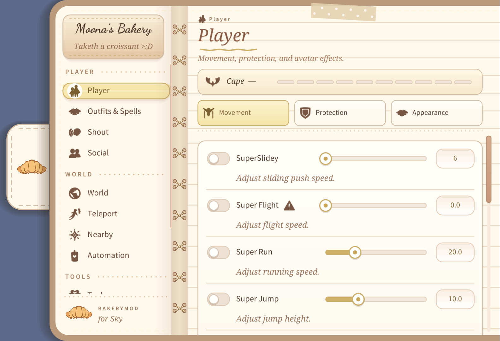
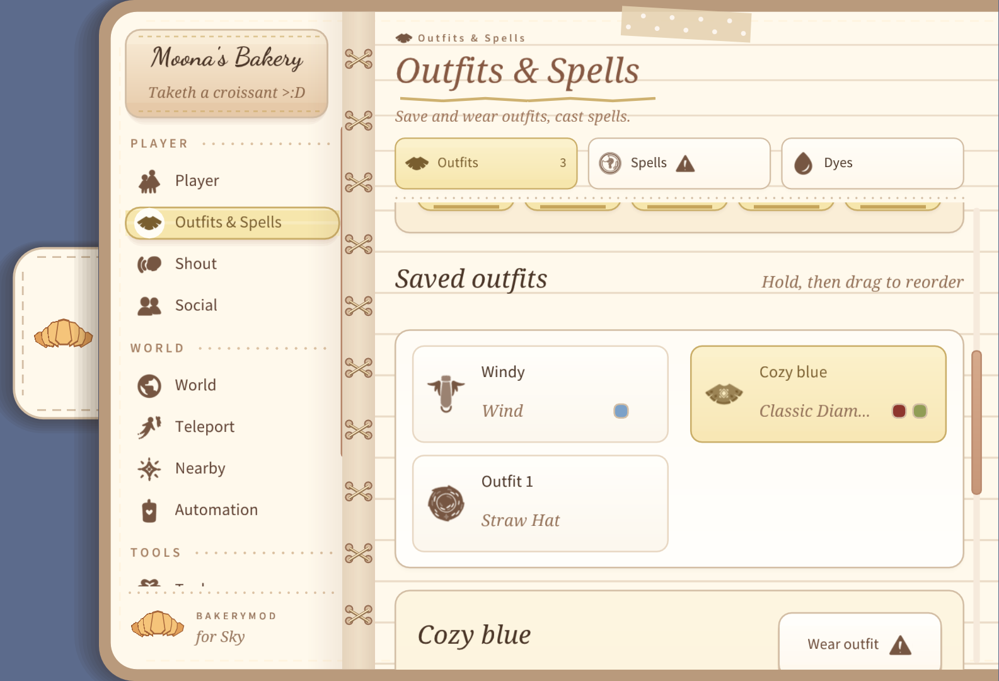
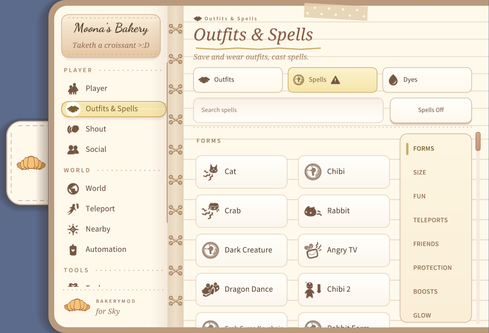
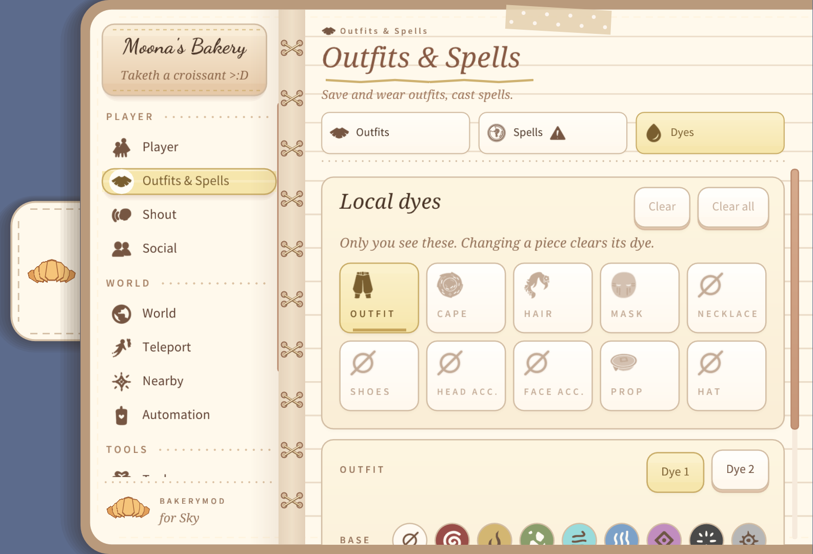
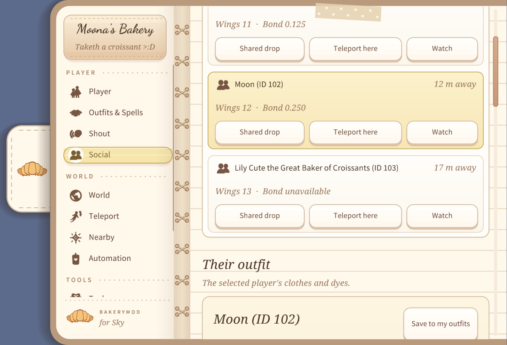
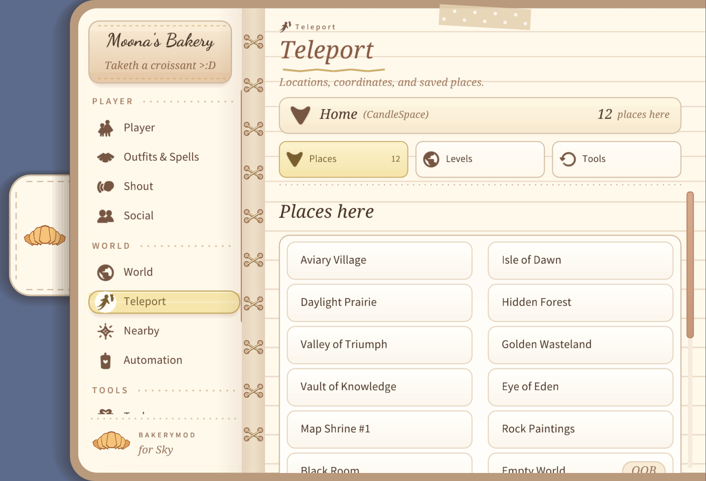
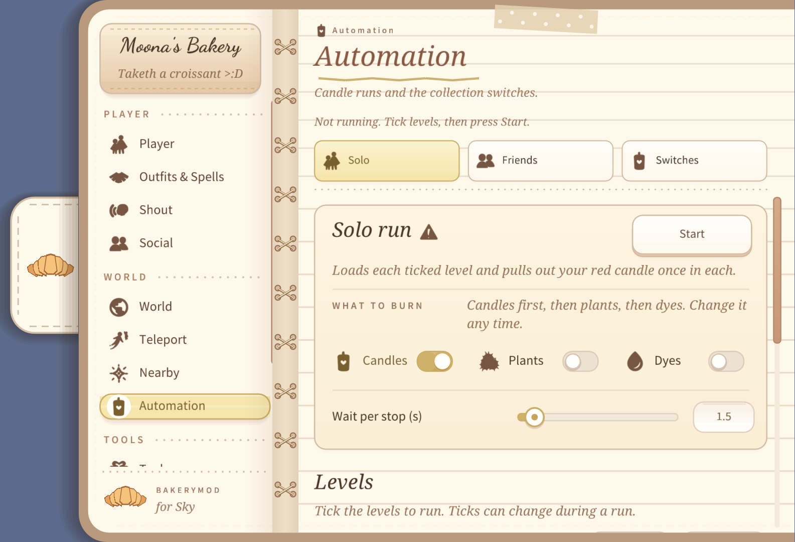
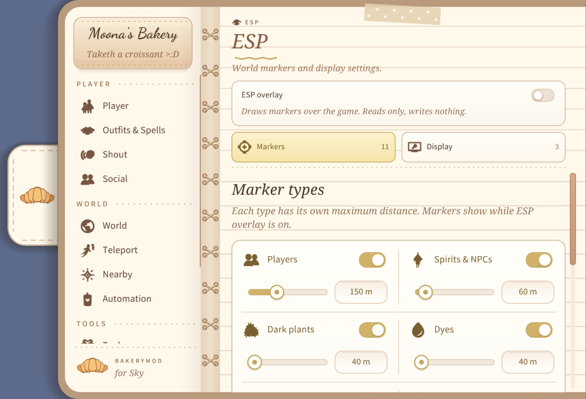
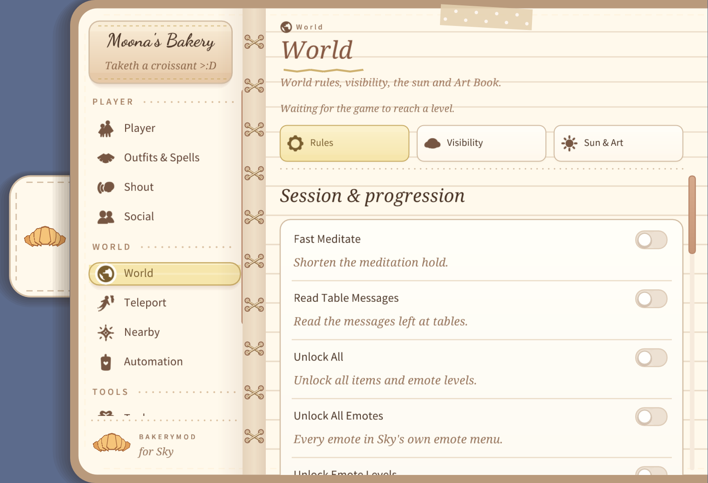
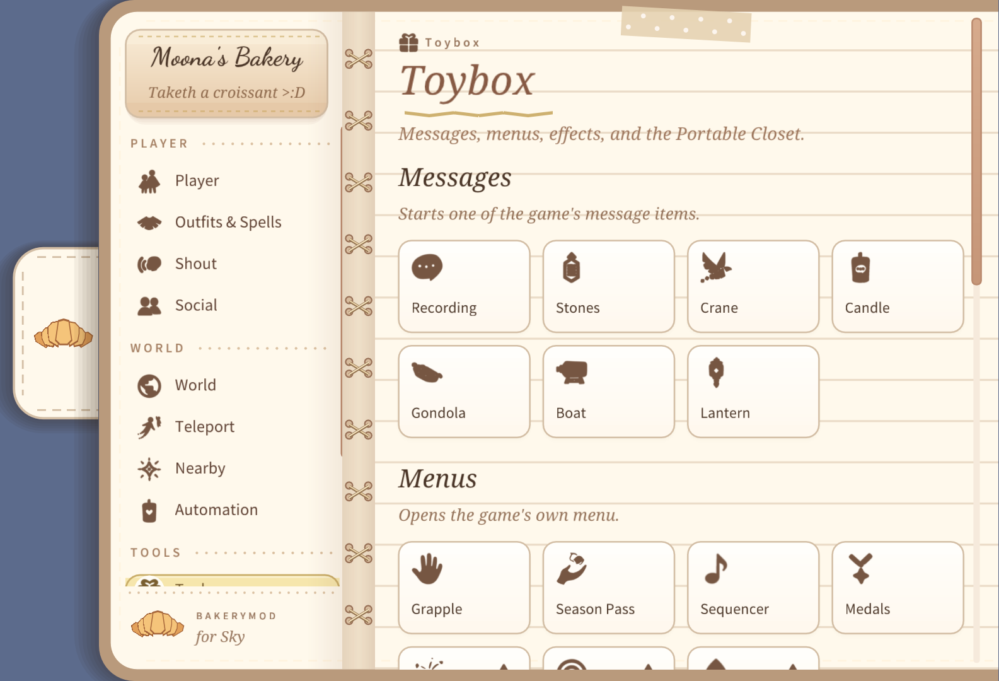

  

<h1 align="center">Moona's Bakery</h1>

  <i>A free mod menu for Sky: Children of the Light on Android, baked fresh by yours truly.</i>

  
  
  

  
  
  
  

  <a href="#couple-peeks"><b>Screenshots</b></a>
  &nbsp;&bull;&nbsp;
  <a href="#how-to-use-it"><b>How to use it</b></a>
  &nbsp;&bull;&nbsp;
  <a href="../../issues"><b>Report a bug</b></a>
  &nbsp;&bull;&nbsp;
  <a href="https://github.com/LunaYuma/MoonasBakery-PC"><b>On PC?</b></a>

> [!IMPORTANT]
> **Moona's Bakery is free. It always has been.** If you paid for it, you got scammed!! Only get it from this repo or my [Discord](https://discord.gg/xpdDNs3nga).
>
> Works with Sky **0.35.5.431758** on Android (ARM64), through **Canvas 1.9.4**. When Sky updates, I'll know! Just wait for a new release.

---

## Fresh from the oven

<table>
  <tr>
    <td width="33%" valign="top">
      <h3>Made for your phone</h3>
      A croissant tab on the edge of your screen opens the menu. Left or right side, your pick, and you can resize it and its text to fit.
    </td>
    <td width="33%" valign="top">
      <h3>Outfits &amp; Spells NEW</h3>
      Save outfits with a name and wear them in one tap. Dye them any color (only on your screen!), roll a random outfit with Undo and Redo, and browse every spell in the game.
    </td>
    <td width="33%" valign="top">
      <h3>Social NEW</h3>
      Everyone in your level in one list. Teleport to them, Watch them, keep a friendship offer up, drop shared winged light, peek at their outfit (and save it!), or send a Pout, Level up or Ancestor glow.
    </td>
  </tr>
  <tr>
    <td valign="top">
      <h3>Candle Runs</h3>
      A semi-auto run that goes realm by realm. It lights candles (the red one too!), burns plants and grabs dyes. Solo, or with Friends!
    </td>
    <td valign="top">
      <h3>Nearby &amp; ESP</h3>
      A numbered list of everything around you, with matching tags, pile counts, and pointers when things are off-screen.
    </td>
    <td valign="top">
      <h3>Made yours NEW</h3>
      The Bakery remembers your switches, and Presets swap between whole sets. Dark mode, and 10 languages with the fonts built right in, so it looks the same on every phone.
    </td>
  </tr>
  <tr>
    <td valign="top">
      <h3>Teleport</h3>
      Every level, the Aviary portals, your own saved spots, coordinates, and a floating Nudge Pad you can drag anywhere.
    </td>
    <td valign="top">
      <h3>World NEW</h3>
      Move the sun and moon, the Art Book look, Hide Game UI, Unlock All, Unlock All Emotes and emote levels, and Auto Complete Quests (alts only!).
    </td>
    <td valign="top">
      <h3>Updates NEW</h3>
      The Bakery tells you when a new version is out, and <b>Update now</b> takes care of the rest. Canvas's <b>Check For Updates</b> works too.
    </td>
  </tr>
</table>

---

## Couple peeks

<table>
  <tr>
    <td width="50%">
<b>Player</b> Movement, protection and effects
</td>
    <td width="50%">
<b>Outfits</b> Save, sort, wear and randomize your outfits
</td>
  </tr>
  <tr>
    <td>
<b>Spells</b> Every spell in the game, with search
</td>
    <td>
<b>Dyes</b> Dye what you wear, only on your screen
</td>
  </tr>
  <tr>
    <td>
<b>Social</b> Players here, Watch, offers and their outfit
</td>
    <td>
<b>Teleport</b> Places, levels and your saved spots
</td>
  </tr>
  <tr>
    <td>
<b>Automation</b> Candle runs, solo or with Friends
</td>
    <td>
<b>ESP</b> Markers for everything around you
</td>
  </tr>
  <tr>
    <td>
<b>World</b> World rules, visibility, sun and Art Book
</td>
    <td>
<b>Toybox</b> Messages, hidden menus and effects
</td>
  </tr>
</table>

---

## What's on the menu

<b>Player</b>

 

| | |
|---|---|
| **Movement** | Super Flight, Super Run, Super Jump, Super Launch, SuperSlidey and Fast Flap, each with a slider (tap any value to type it in) |
| **Modes** | Crawl Mode, Scooter Mode, **Jesus Mode** (walk on water), Bounce |
| **Camera** | Free Zoom, **Lock Camera Position** |
| **Protection** | Infinite Energy, No Drain, Infinite Oxygen, Anti Krill, Anti AFK |
| **Winged Light** | Drop (loses real light, tap twice to confirm) |
| **Elder armor** | Armor Immunity, Repair Elder Armor, Break Elder Armor |
| **Appearance** | Fake Cape Level, Remove Cape, iOS Headphones, Unlimited Fireworks, Spell Emitter |
| **Avatar effects** | Rainbow, Spirit Shader, Inner Glow, Tattered Cape, Eden Glider, Child of Light |
| **Forms & spells** | Cat, Chibi, Crab, Rainbow Trail, Spells Off |
| **Extras** | Unlight Avatar, Kill Avatar |

<b>Outfits</b> NEW

 

- Save what you're wearing with a name. Clothes and dyes!
- Every saved outfit shows its cape with Sky's own item icons
- **Wear** it again in one tap (your props stay right where they were)
- Hold an outfit, then drag it to reorder. Rename it, Replace it with what you're wearing, or Delete it (Replace and Delete ask twice)
- **Dyes tab:** dye your outfit any color you like, only on your screen. The spots Sky can't dye stay locked, just like in Sky
- **Random outfit:** tap Randomize, with Undo and Redo, and tick which slots it's allowed to change
- **Spells tab:** every spell in the game in one list, with search and a category index
- Your outfits are saved in a file (`BakeryOutfits.json`, same as the PC version)

<b>Social</b> NEW

 

| | |
|---|---|
| **Players here** | See who's around, **Teleport here** or **Watch** them with their camera, or send a **Shared drop** of winged light at them (everyone sees it, nobody loses any) |
| **You offer them** | Keep any friendship offer up for the player you pick, with or without the offering pose |
| **They offer you** | Have them offer you a hand hold, a piggyback or a princess carry (on your screen) |
| **Their outfit** | See their clothes and dyes, and save it to your own outfits |
| **Sends** | Pout, Level up or Ancestor (makes them glow) for the player you picked |

<b>World</b> NEW

 

| | |
|---|---|
| **Rules** | Fast Meditate, Read Table Messages, Unlock All, **Unlock All Emotes**, **Unlock Emote Levels**, Relationship Abilities, Game Speed, Prevent Session Split, **Auto Complete Quests** (use that one only on an alt!) |
| **Disable** | Spirit Gates, Wind Walls, Cutscenes, Gravity, Multiplayer |
| **Players** | Show All Spirits, Light All Players, Reveal All Players, Hide Other Players, Birthday Krills |
| **Hide** | **Hide Game UI**, plus the clouds, terrain, ocean, objects, models, candle flames and more |
| **Effects** | World Glow, World Dim, Black & White, Surreal Blue |
| **Sun & Art** | Move the sun and moon live, the Art Book look (with a "Dear Van Gogh" reset), Giant Flowers, Freeze Time |

<b>Teleport</b>

 

- Jump to places in every level, including the Aviary portals and a few out-of-bounds spots
- Load any level, with Portal mode and fade options
- Type in coordinates (or copy your own), save your own spots, Go Back, Reload, Title Gate
- **Nudge Pad:** a floating pad for small hops, drag it wherever it's comfy

<b>Nearby</b>

 

- A numbered list of candles, seasonals, dark plants, dyes, winged light, Eden deposits, tickets and dig spots, with how far away each one is
- Pick one and teleport right to it

<b>Automation</b>

 

| | |
|---|---|
| **Candle Run** | Tick the levels, pick what to burn (candles, plants, dyes), and it does the rest. Lights the red candle too! |
| **Solo** | Loads each level for you |
| **Friends** | Walks through the exits, realm by realm, and waits at load-ins so your friends stay with you |
| **Run panel** | Shows the level you're in, with Stop, Previous and Next |
| **Switches** | Auto Burn Candles / Plants / Dyes, Faster Plant Burning, Auto Collect Wax, Auto Collect Fragments |

<b>Toybox</b> NEW

 

| | |
|---|---|
| **Messages** | Recording, Stones, Crane, Candle, Gondola, Boat, Lantern |
| **Hidden menus** | Fireworks, Grapple, Season Pass, Sequencer, Audience, Dye, Medals |
| **Effects & camera** | Gift, Presence, Hide Trail, Purchase, Level Up, Firework, Screenshot Pose, **Cape Upgrade**, **Radiance** |
| **Closet** | Portable Closet: open the closets from anywhere, with a reach slider |

<b>Shout</b>

 

- Pick your own shout color, or go **Rainbow** with its own speed
- Other players see your shout color too

<b>ESP</b>

 

- Markers for players, spirits & NPCs, dark plants, dyes, wing lights, Eden deposits, candles, seasonals, tickets, dig spots and krill
- Things that sit together pile up into one tag with a count
- Every type has its own max distance, and turns into a pointer when it's off-screen
- Tags in Cream or Dark glass, or the Legacy motes style
- Labels (numbered like the Nearby list), distance, guide lines, scale by distance, overlay, text and pointer size
- A refresh rate slider, so you can trade a little smoothness for more FPS

<b>Settings</b>

 

- **Language:** English, Українська, Русский, 日本語, 简体中文, 繁體中文, Bahasa Indonesia, Español, Français, Tiếng Việt
- **Presets:** save your switches and sliders as a named set, and swap between them
- Interface size, **Text size** (100-150%), menu width, opacity and **Dark mode**
- Put the menu on the **left or right** side (hi, left-handed bakers!)
- Hide the croissant tab, or hide Canvas's own menu button
- The Bakery remembers your switches and settings between sessions

---

## How to use it

| Step | What to do |
|:---:|---|
| **1** | Install **Canvas** if you don't have it yet: grab `Canvas.apk` from [Canvas's releases](https://github.com/skyprotocol/canvas-distribution/releases/latest). |
| **2** | Grab the newest **`libMoonasBakery-vX.X.X.so`** from the [Releases](../../releases/latest) page. |
| **3** | Open Canvas, go to **Mods**, tap **Add mod** and pick the `.so` file you downloaded. |
| **4** | Tap **PLAY** in Canvas to start Sky. |
| **5** | Tap the **croissant tab** on the edge of your screen to open the menu. |

> [!TIP]
> **Updating?** The Bakery tells you when a new version is out. Tap **Update now** and it takes care of the rest, then restart Sky.
> You can also tap **Check For Updates** on Moona's Bakery in Canvas, then **Install**. No re-adding needed.

---

## Please read

> [!WARNING]
> Modding breaks Sky's Terms of Service. **You use this at your own risk**, and your account is your responsibility.

- This mod is **not affiliated with or endorsed by thatgamecompany**.
- I only add features I've tested myself.
- Features that could get you in trouble wear Sky's own **Report** icon (be careful) or **Block** icon (alts only).
- The Bakery sends an anonymous ping when it starts, with a random install ID and the mod version, so I can count how many people use the mod and the menu can tell you about updates.
- **ARM64 Android only**, through Canvas. On PC? Go to [MoonasBakery-PC](https://github.com/LunaYuma/MoonasBakery-PC).
- When Sky updates, the mod stops working until I put out a new build. Watch this repo to get notified.
- Big thanks to the Canvas team for making Android modding possible ^^

---

## Found a bug?

Open an [Issue](../../issues) and tell me:

- What you were doing
- What happened vs. what you expected
- Your phone model and Android version
- Attach `bakery.log` (and `bakery.prev.log` if the game crashed) from `Android/data/git.artdeell.skymodloader/files/MoonasBakery/`. It's plain text, no personal info

---

  <b>Oh, and come hang out in my Discord!!</b>  
  

